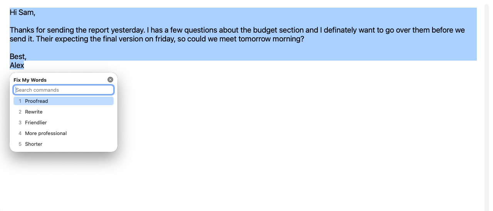
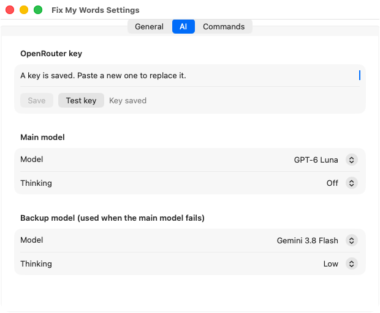
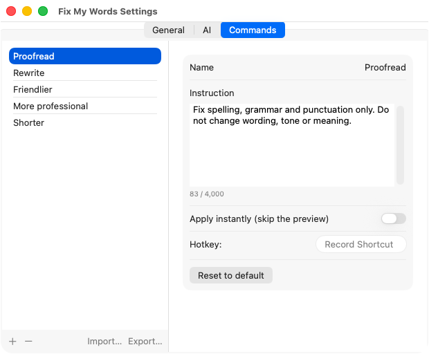

# Fix My Words

**Fix your writing in other Mac apps with one shortcut.**

Fix My Words is a native macOS menu bar app. Select text in another app, press a keyboard shortcut, and pick a command such as Proofread, Rewrite or Shorter. An AI model you choose through OpenRouter fixes the text, shows you what changed, and pastes the new version back in place.

https://github.com/user-attachments/assets/051e16ab-399c-46f1-9704-0e8959f908e2

*In the demo, a short email with four mistakes is selected, proofread and pasted back, then made friendlier the same way.*

## What it does

Five commands come built in:

- **Proofread**: fixes spelling, grammar and punctuation only, without changing wording, tone or meaning.
- **Rewrite**: makes the text read more clearly, at about the same length.
- **Friendlier**: makes the text warmer and friendlier.
- **More professional**: makes the text more polished.
- **Shorter**: makes the text shorter and keeps every important point.

You can also:

- Add your own commands, edit the instruction behind any command, and reset a built-in command to its default. You can import or export your commands as JSON.
- Give any command its own keyboard shortcut, which skips the command list.
- Turn on **Apply instantly** for a command, so its result is pasted without the review step.
- Look back at earlier fixes in a searchable History window. Entries older than 30 days are removed over time, and Clear deletes them all.
- Pick a main model and a backup model from OpenRouter's model list, each with its own thinking level. If the main model fails with a temporary error, Fix My Words retries it once, then asks the backup model. Key and credit errors stop with a message instead.

## How it works

1. Select text in another app.
2. Press Command-Shift-W (⌘⇧W). A command list opens next to the selection, or at the pointer when the app does not say where the selection is. Type to search, use the arrow keys and Return, or press a number from 1 to 9. Press Esc to close the list.
3. Pick a command. The answer streams into a panel. When it finishes, the panel shows two columns: **Changes**, with each change highlighted word by word, and **New version**, the clean text.
4. Press Return to replace your selection, ⌘C to copy the result, or Esc to discard it.



You can change the main shortcut in Settings → General. Choose **Pause** in the menu bar menu to turn off all shortcuts, so ⌘⇧W reaches the app in front again.

Before it pastes, Fix My Words checks that the same text box still has focus. If you have moved on, it pastes nothing and offers Copy instead. If the model finds nothing to change, the panel shows "No changes needed." and closes.

## Install

There is no download yet. To use Fix My Words today, [build it from source](#build-from-source).

You need:

- macOS 26 or later.
- An [OpenRouter](https://openrouter.ai) account and API key with credit. Each fix is a paid request to the model you choose.

## First run

1. **Accessibility permission.** Fix My Words reads your selection and pastes the result through macOS Accessibility. On first launch, a window explains this. Click **Open System Settings** and turn on Fix My Words under Privacy & Security → Accessibility. The window closes itself once the permission is granted. No other permission is needed.
2. **OpenRouter key.** Click the menu bar icon, choose Settings…, open the AI tab, paste your key, click Save, then click Test key.
3. **Models.** On the same tab, pick a main model and a backup model.
4. **Start at login.** The Release build from [Build from source](#build-from-source) adds itself as a login item on first launch. Turn this off in Settings → General → Start at login.

 

*Settings → AI (example models) and Settings → Commands.*

## Privacy

- **Nothing is read until you press a shortcut.**
- **What is sent:** when you pick a command, Fix My Words sends the selected text, the command's instruction and a fixed system prompt to OpenRouter (`https://openrouter.ai/api/v1/chat/completions`) over HTTPS, with your key. Each request also carries two headers that name the app, not you: `HTTP-Referer: https://github.com/iHateCode/fix-my-words` and `X-Title: Fix My Words`. OpenRouter passes it to the provider of the model you chose. The system prompt tells the model to treat your text as text to edit, never as instructions to follow.
- **Other requests:** opening Settings → AI fetches OpenRouter's public model list, and Test key checks your key with OpenRouter. There is no analytics or telemetry.
- **What is stored on your Mac:** your key in the login Keychain, on this Mac only (not synced). Your commands and, if History is on, your original and fixed text, in `~/Library/Application Support/FixMyWords/`. Only your user can read that folder. Entries older than 30 days are hidden when the app starts and removed from disk the next time a fix is saved to History. Turning History off stops new entries but keeps the saved ones until you click Clear.
- **Clipboard:** when Fix My Words copies your selection or pastes the result, it saves your clipboard first and puts it back afterwards (after a paste, only if no other app has changed the clipboard since). It marks the pasted text so clipboard managers that respect that marker skip it. Other clipboard managers may still record it. The Copy buttons put text on your clipboard like any other copy.

## Limits

- macOS only, OpenRouter only. The app's interface is in English only; the built-in commands are written and tested in English.
- Not sandboxed, and not on the Mac App Store, because the App Sandbox would block reading and pasting in other apps.
- In Chrome, Edge, Teams and other Chromium or Electron apps, it copies the selection with a guarded ⌘C instead of reading it through Accessibility. It works in Microsoft Word, Outlook and Teams.
- Over 20,000 characters, the panel shows the result without highlighted changes.

## How it compares

Apple's Writing Tools and Grammarly do similar jobs. Fix My Words is different in three ways: you choose the model through OpenRouter, you write your own commands, and you see every change before it is pasted.

## Build from source

You need Xcode 27 or later (tested with 27.2) and [XcodeGen](https://github.com/yonaskolb/XcodeGen) (`brew install xcodegen`).

1. Clone the repository, generate the Xcode project, build a Release copy into the `build` folder and open it:

   ```sh
   git clone https://github.com/iHateCode/fix-my-words.git
   cd fix-my-words
   xcodegen generate
   xcodebuild -project FixMyWords.xcodeproj -scheme FixMyWords -configuration Release -derivedDataPath build build
   open build/Build/Products/Release/FixMyWords.app
   ```

   The app has no Dock icon: look for the icon in the menu bar. On first launch, the Release build adds itself as a login item; turn this off in Settings → General → Start at login.

   This works with no Apple account: the app is signed ad hoc. The catch is that macOS then asks for the Accessibility permission again after each rebuild.

2. To keep the permission across rebuilds, sign with your own team. A free personal team is fine: add your Apple ID in Xcode → Settings → Accounts. Then:

   ```sh
   cp Config/Signing.local.xcconfig.example Config/Signing.local.xcconfig
   ```

   In `Config/Signing.local.xcconfig`, set `DEVELOPMENT_TEAM` to your team ID and keep the line `CODE_SIGN_IDENTITY = Apple Development`. Run `xcodegen generate`, then the `xcodebuild` and `open` commands from step 1 again. `Config/Signing.local.xcconfig` is ignored by git.

macOS ties the Accessibility permission to the app's location and signature. Keep building with the same team and running the app from the same place, `build/Build/Products/Release/FixMyWords.app`. If you move the app or change how it is signed, macOS may ask for Accessibility again. If the permission stops working after a rebuild, remove Fix My Words from the Accessibility list and add it again.

Builds signed with a free personal team only run on the Mac that built them. Giving the app to other people needs a paid Apple Developer account and notarisation.

## Inspiration

Fix My Words takes ideas from [WritingTools](https://github.com/theJayTea/WritingTools) and the forks people have built on it. WritingTools is licensed under GPLv3. Fix My Words is a separate codebase and does not copy its code.

## Contributing

Please open an issue to discuss a change before you send a pull request.

To build, follow [Build from source](#build-from-source). The UI tests in `FixMyWordsUITests/` drive the built app against TestPad, a small test app, and a stub OpenRouter server on your Mac, so they need no real key and make no paid calls. They take over the keyboard and mouse while they run. Grant Accessibility to the test runner and to Fix My Words in System Settings (once, if you sign with your own team as in step 2 of [Build from source](#build-from-source); after every rebuild otherwise), then run:

```sh
xcodebuild -project FixMyWords.xcodeproj -scheme FixMyWords -destination 'platform=macOS' test
```

### Re-recording the README media

`scripts/record-demo.sh` runs the demo-only UI tests and writes the screenshots, `docs/images/demo.mp4` and its poster to `docs/images/`. It needs XcodeGen, `ffmpeg` and `jq`, and Screen Recording permission for your terminal. Run `scripts/record-demo.sh shots` or `scripts/record-demo.sh video` to redo only one part.

## Security

To report a security problem, see [SECURITY.md](SECURITY.md). Please do not open a public issue for it.

## License

MIT. See [LICENSE](LICENSE).

Fix My Words uses [KeyboardShortcuts](https://github.com/sindresorhus/KeyboardShortcuts), which is MIT licensed; its notice is in [THIRD_PARTY_NOTICES.md](THIRD_PARTY_NOTICES.md).
